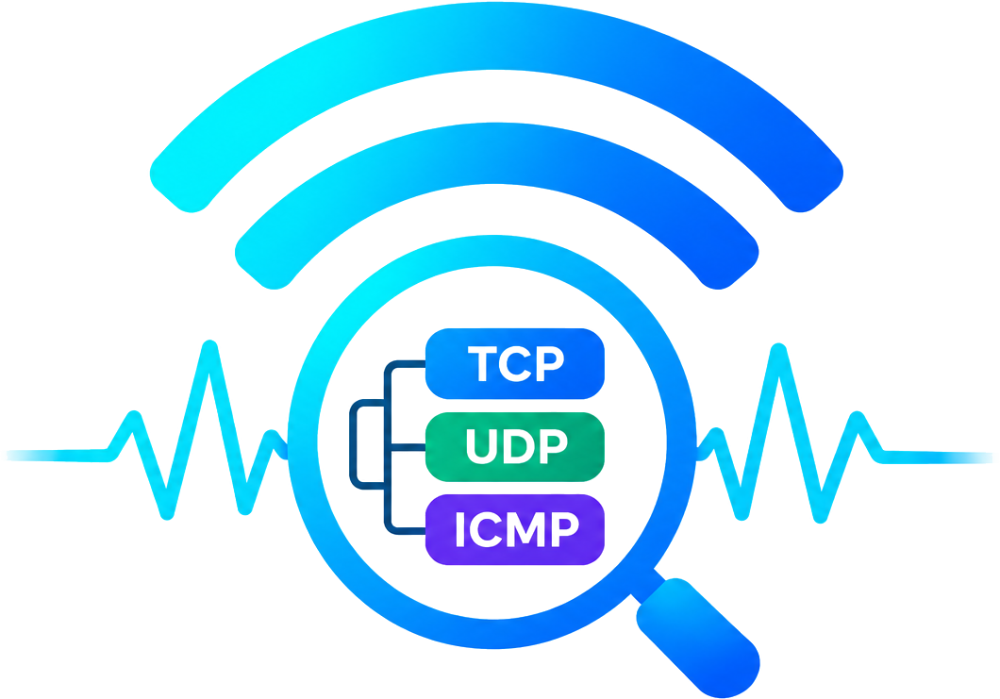

# Airtrace

<p align="center">
  
</p>

<p align="center">
  <strong>Inspect. Understand. Analyze.</strong><br>
  <em>A high-precision, passive network traffic analyzer and real-time protocol telemetry console engineered for systems and wireless engineers.</em>
</p>

<p align="center">
  
  
  
  
  
  
</p>

---

## Executive Overview

**Airtrace** is an open-source, passive network traffic analyzer developed as a technical portfolio project for wireless systems and network engineering. It bridges the gap between raw command-line packet sniffers (`tcpdump`) and heavyweight enterprise protocol analyzers (Wireshark) by providing wire-accurate protocol decoding, real-time rolling throughput telemetry, and an interactive dark-cockpit dashboard designed around tabular density, high contrast, and sub-millisecond feedback.

Airtrace operates as a **local-first, passive diagnostic tool**. It prioritizes deterministic protocol interpretation, thread-safe concurrency management, and metadata inspection while enforcing a strict **zero-payload retention** privacy policy.

---

## Engineering Highlights

* **Decoupled Pure-Python Architecture:** The core packet decoding engine, sliding-window statistics aggregator, and capture worker have zero dependencies on the Streamlit presentation layer, enabling 100% offline unit testability.
* **Concurrency & Rerun Protection:** Solves Streamlit's reactive execution model using an idempotent `CaptureController` singleton protected by an atomic `threading.RLock()`, preventing duplicate background capture threads during UI interactions.
* **Sliced Sniffing Lifecycle:** Implements non-blocking, sliced socket sniffing (`timeout=0.5s`) inside a monitored worker thread, guaranteeing clean and instantaneous terminations without hanging on idle network interfaces.
* **Dual-Mode Operation:** Supports live hardware capture via Npcap on Windows/Linux, with automatic graceful fallback to an integrated **Synthetic Simulation Adapter** for instant testing and demonstration without administrative driver privileges.
* **Rolling Time-Window Telemetry:** Maintains a monotonic 5.0-second sliding rate window to calculate true wire-rate Packets Per Second (PPS) and Bytes Per Second (BPS).
* **Metadata-Only Security:** Extracts and exports protocol headers only. Raw packet payloads (HTTP request bodies, credentials, tokens) are never stored in memory or written to disk.

---

## Architectural Blueprint

```
┌────────────────────────────────────────────────────────────────────────┐
│                        Streamlit UI Presentation                       │
│  ┌──────────────┐  ┌───────────────────┐  ┌───────────┐  ┌───────────┐ │
│  │ Command Deck │  │ Real-time Metrics │  │ Charts    │  │ Explorer  │ │
│  └──────┬───────┘  └─────────▲─────────┘  └─────▲─────┘  └─────▲─────┘ │
└─────────┼────────────────────┼──────────────────┼──────────────┼───────┘
          │ User Triggers      │ Pull Snapshots   │ Query Data   │ Filter / Search
          ▼                    │                  │              │
┌──────────────────────────────┴──────────────────┴──────────────┴───────┐
│                     Capture Controller (Singleton)                     │
│   - State Machine: IDLE | CAPTURING | STOPPING | ERROR                 │
│   - Atomic Re-entrancy Lock & Thread Safety Guard                      │
└──────────────────────────────┬─────────────────────────────────────────┘
                               │ Coordinates Lifecycle
                               ▼
┌────────────────────────────────────────────────────────────────────────┐
│                    Background Capture Worker (Thread)                  │
│   - Scapy sliced sniff(timeout=0.5s, store=False)                      │
│   - Controlled by threading.Event (stop_event)                         │
└──────────────────────────────┬─────────────────────────────────────────┘
                               │ Raw Wire Frame
                               ▼
┌────────────────────────────────────────────────────────────────────────┐
│                          Packet Decoder Engine                         │
│   - Pure functional parser: IPv4 -> (TCP | UDP | ICMP | OTHER)        │
│   - Produces immutable, lightweight PacketRecord dataclasses           │
└──────────────────────────────┬─────────────────────────────────────────┘
                               │ Normalized Record
                               ▼
┌────────────────────────────────────────────────────────────────────────┐
│                  Thread-Safe FIFO Queue (maxsize=10,000)               │
└──────────────────────────────┬─────────────────────────────────────────┘
                               │ Dequeue / Batch Drain
                               ▼
┌────────────────────────────────────────────────────────────────────────┐
│                       Statistics & Aggregation Engine                  │
│   - Bounded Ring Buffer (collections.deque(maxlen=5,000))              │
│   - Rolling Rate Windows (5-second monotonic window for PPS & BPS)     │
│   - Protocol Counters & Top Talker IP Frequency Counters               │
│   - Thread-safe snapshot generator for UI ingestion                    │
└──────────────────────────────┬─────────────────────────────────────────┘
                               │ Export Trigger
                               ▼
┌────────────────────────────────────────────────────────────────────────┐
│                          Metadata CSV Exporter                         │
│   - ISO 8601 timestamps, RFC-compliant CSV, zero payload retention     │
└────────────────────────────────────────────────────────────────────────┘
```

---

## Protocol Decoding Specification

Airtrace implements a deterministic, ordered decoding pipeline strictly classifying IPv4 traffic:

$$\text{Packet} \longrightarrow \text{IPv4 Check} \longrightarrow \text{TCP} \longrightarrow \text{UDP} \longrightarrow \text{ICMP} \longrightarrow \text{OTHER}$$

| Protocol Layer | Extracted Metadata Fields | Engineering Significance |
| :--- | :--- | :--- |
| **IPv4 Layer** | Source IP, Destination IP, TTL, IP Protocol ID, Total Header Length, Identification, Fragmentation Flags (`DF`, `MF`), Fragment Offset | Identifies route hops (TTL), packet reassembly needs, and transmission paths across subnets. |
| **TCP Layer** | Source Port, Destination Port, Sequence Number, Acknowledgment Number, Window Size, TCP Flags (`SYN`, `ACK`, `FIN`, `RST`, `PSH`, `URG`, `ECE`, `CWR`) | Evaluates 3-way handshake mechanics, flow control windows, and connection teardown behavior. |
| **UDP Layer** | Source Port, Destination Port, Length, Checksum | Monitors connectionless datagram flows, DNS query/reply transactions, and streaming media. |
| **ICMP Layer** | Type, Code, Checksum, Identifier, Sequence Number | Diagnoses network reachability, echo request/reply round-trips, and routing error reports. |
| **OTHER** | Source/Destination IP, Protocol ID, Wire Length | Captures fallback transport protocols (e.g. IGMP multicast, GRE, ESP, OSPF). |

---

## Concurrency & Lifecycle Architecture

### 1. Preventing Duplicate Workers During UI Reruns
Streamlit re-executes the top-level script (`app.py`) on every user interaction (clicks, dropdown selections, timer ticks). If background threads are spawned naively, repeated clicks create duplicate sniffers that corrupt statistics and exhaust system resources.

Airtrace eliminates this with multi-tiered protection:
* **Session-State Singleton:** The `CaptureController` instance is created once and bound to `st.session_state["controller"]`.
* **Atomic Re-entrancy Lock:** `controller.start_capture()` is wrapped in a `threading.RLock()`. If `controller.is_running` is already active, subsequent calls immediately return `False` as a safe no-op.

### 2. Sliced Sniffing Pattern (Clean Stops on Windows)
Standard Scapy `sniff(stop_filter=...)` only evaluates stopping conditions *after* a packet is received on the wire. On an idle or quiet network, calling stop causes the worker thread to hang indefinitely waiting for the next packet.

Airtrace resolves this using a bounded sliced sniffing loop:
```python
def _run_live_sniff(self):
    while not self.stop_event.is_set():
        try:
            sniff(
                iface=self.interface,
                prn=self._process_scapy_packet,
                store=False,            # Zero raw packet memory retention
                timeout=0.5,            # Slice timeout guarantees stop check every 500ms
                filter=self.bpf_filter or ""
            )
        except Exception as e:
            self._handle_error(e)
            break
```
When the user clicks **STOP**, `stop_event.set()` is signaled, the current 500ms slice expires, and the thread terminates cleanly within half a second.

---

## Project Structure

```
Airtrace/
├── app.py                      # Main Streamlit dashboard coordinator & styling
├── requirements.txt            # Pinned runtime dependencies
├── README.md                   # Technical documentation and architecture guide
├── IMPLEMENTATION_PLAN.md      # Engineering roadmap and design specifications
├── .gitignore                  # Git exclusion rules
│
├── airtrace/                   # Decoupled Pure Python Core
│   ├── __init__.py             # Version metadata
│   ├── config.py               # Constants, buffer capacities, and color tokens
│   ├── models.py               # Dataclasses: PacketRecord, CaptureStats, Interfaces
│   ├── interfaces.py           # Windows/Linux adapter discovery & driver diagnostics
│   ├── decoder.py              # Pure-function packet parser (IPv4, TCP, UDP, ICMP)
│   ├── statistics.py           # Rolling rates, metrics engine, and ring buffers
│   ├── capture.py              # Sliced capture worker & thread lifecycle controller
│   ├── filters.py              # In-memory protocol filtering, search, and BPF validation
│   └── exporter.py             # Sanitized metadata CSV serialization
│
├── components/                 # Presentation Components
│   ├── header.py               # Floating brand card, transparent logo & status beacon
│   ├── capture_controls.py     # Command Deck toolbar with adapter selection
│   ├── metric_cards.py         # Glassmorphic KPI tiles (Packets, Volume, Rates, Mix)
│   ├── protocol_charts.py      # Altair protocol donut chart and top endpoints
│   ├── packet_table.py         # Searchable, filterable packet explorer
│   └── packet_details.py       # Deep packet inspector drawer
│
├── tests/                      # Automated Pytest Suite (100% Offline)
│   ├── conftest.py             # Synthetic Scapy packet fixtures
│   ├── test_decoder.py         # Protocol classification & header field tests
│   ├── test_capture.py         # Lifecycle and thread re-entrancy tests
│   ├── test_statistics.py      # Rolling rate math and ring buffer tests
│   ├── test_filters.py         # Search and filtering predicate tests
│   └── test_exporter.py        # CSV format compliance and privacy tests
│
└── assets/
    ├── logo.png                # Original brand mark
    └── logo_transparent.png    # Optimized transparent retina asset
```

---

## Installation & Getting Started

### Prerequisites

1. **Python 3.11+** installed on Windows or Linux.
2. **Npcap (Windows Live Capture):**
   * Download and install from [npcap.com](https://npcap.com/).
   * Select **"Install Npcap in WinPcap API-compatible Mode"** during installation.
   * *Note:* If Npcap is not present, Airtrace automatically provides the **"Airtrace Synthetic Demo Adapter"**, allowing complete evaluation of decoding, streaming telemetry, and export immediately.

### Setup Instructions

```powershell
# 1. Clone the repository
git clone https://github.com/Aswinsaipalakonda/Airtrace.git
cd Airtrace

# 2. Create and activate a virtual environment
python -m venv .venv
# On Windows PowerShell:
.venv\Scripts\Activate.ps1
# On Linux / macOS:
source .venv/bin/activate

# 3. Install dependencies
pip install -r requirements.txt
```

### Launching the Dashboard

```powershell
streamlit run app.py
```
Open **`http://localhost:8501`** in your browser to access the console.

---

## Testing & Validation Strategy

### 1. Automated Test Suite
Airtrace includes 14 automated unit tests verifying every core subsystem using synthetic in-memory packets (zero live network or root requirements):

```powershell
python -m pytest tests/ -v
```

```
============================= test session starts =============================
collected 14 items

tests/test_capture.py::test_capture_controller_lifecycle PASSED          [  7%]
tests/test_decoder.py::test_decode_tcp_packet PASSED                     [ 14%]
tests/test_decoder.py::test_decode_udp_packet PASSED                     [ 21%]
tests/test_decoder.py::test_decode_icmp_packet PASSED                    [ 28%]
tests/test_decoder.py::test_decode_other_packet PASSED                   [ 35%]
tests/test_decoder.py::test_decode_non_ip_packet_returns_none PASSED     [ 42%]
tests/test_decoder.py::test_format_tcp_flags PASSED                      [ 50%]
tests/test_exporter.py::test_export_to_csv PASSED                        [ 57%]
tests/test_filters.py::test_filter_by_protocol PASSED                    [ 64%]
tests/test_filters.py::test_filter_by_search_query PASSED                [ 71%]
tests/test_filters.py::test_validate_bpf_filter PASSED                   [ 78%]
tests/test_statistics.py::test_statistics_engine_counters PASSED        [ 85%]
tests/test_statistics.py::test_statistics_engine_history_limit PASSED   [ 92%]
tests/test_statistics.py::test_statistics_engine_reset PASSED           [100%]

============================== 14 passed in 0.91s ==============================
```

### 2. Wireshark Cross-Validation
To validate Airtrace against an independent reference standard:
1. Launch Wireshark and Airtrace simultaneously bound to the same adapter (e.g. Wi-Fi).
2. Set matching BPF filters on both tools (e.g., `ip and host 1.1.1.1`).
3. Generate controlled network traffic from a separate terminal:
   ```powershell
   # ICMP Echo validation
   ping -n 4 1.1.1.1

   # UDP DNS resolution
   nslookup cloudflare.com 1.1.1.1

   # TCP Handshake validation
   curl -I https://example.com
   ```
4. Verify that packet counts, IP total lengths, TTLs, and TCP sequence/ack numbers match between Airtrace and Wireshark.

---

## Privacy & Responsible Use

Airtrace is built strictly for educational, research, and authorized diagnostic analysis:
* **Authorized Monitoring Only:** Users must capture traffic only on networks and devices they own or have explicit administrative permission to inspect.
* **Metadata-Only Retention:** Airtrace never captures, records, or exports application-layer payloads (HTTP bodies, session cookies, passwords, API tokens).
* **Local Operation:** Telemetry and capture records remain strictly on the local machine; zero data is transmitted to third-party cloud services.
* **Repository Safety:** Generated `.pcap` files and CSV metadata exports are permanently excluded from Git tracking via `.gitignore`.
