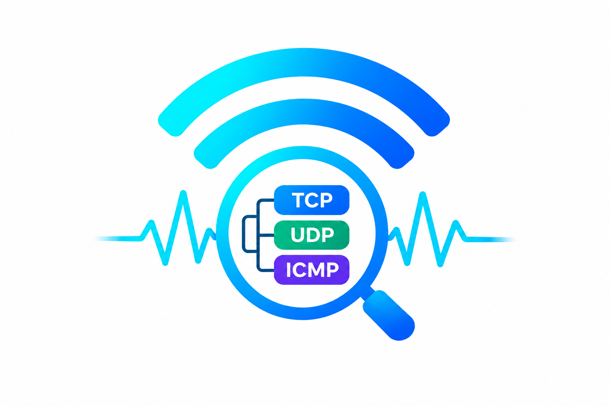

# Airtrace

<p align="center">
  
</p>

<p align="center">
  <strong>Inspect. Understand. Analyze.</strong><br>
  <em>A high-precision network traffic analyzer and protocol inspection console built for wireless and systems engineers.</em>
</p>

---

## Overview

**Airtrace** is a modular Python-based network traffic analyzer designed for network engineers, wireless systems students, and security learners. It captures packets from user-selected network interfaces, decodes IPv4, TCP, UDP, and ICMP protocols with sub-millisecond precision, aggregates real-time traffic statistics, and presents metadata through a clean, high-density engineering dashboard.

Airtrace operates as a passive, local diagnostic tool prioritizing wire-accurate packet decoding, lifecycle stability, and metadata analysis over opaque visual effects.

---

## Key Features

- **Live & Offline Packet Capture:** Interactively capture live traffic via Npcap/Scapy or run in synthetic simulation mode for testing and demonstrations.
- **Accurate Protocol Decoding:**
  - **IPv4:** Source/Destination IP, TTL, Protocol ID, Header Length, Total Length, Identification, Fragmentation flags.
  - **TCP:** Source/Destination Ports, Sequence & Acknowledgment numbers, Flags (SYN, ACK, FIN, RST, PSH, URG), Window size, Data Offset.
  - **UDP:** Source/Destination Ports, Length, Checksum.
  - **ICMP:** Type, Code, Checksum, Sequence, and Identifier fields.
  - **OTHER:** Safe fallback classification for other transport protocols (IGMP, ESP, GRE, etc.).
- **Real-Time Traffic Analytics:** Instantaneous and rolling (5-second window) metrics for Packets/Second (PPS), Bytes/Second (BPS), average packet size, and protocol distribution.
- **Thread-Safe Architecture:** Background capture worker with bounded queues preventing Streamlit rerun duplication and UI lockups.
- **Searchable Packet Explorer:** Dynamic filtering by protocol and search by IP addresses or port numbers.
- **Metadata CSV Export:** Export audit-ready capture records in ISO 8601 format without recording or leaking payload contents.
- **Comprehensive Offline Test Suite:** Fully tested via synthetic packets with zero live network or root privilege requirements for unit tests.

---

## Architecture

```
┌────────────────────────────────────────────────────────┐
│                   Streamlit UI Layer                   │
│   Dashboard | Capture Controls | Explorer | Export     │
└───────────────────────────┬────────────────────────────┘
                            │ Queries / Snapshot
                            ▼
┌────────────────────────────────────────────────────────┐
│                Capture Lifecycle Manager               │
│     Singleton Controller | State Guard | Stop Event    │
└───────────────────────────┬────────────────────────────┘
                            │ Controls
                            ▼
┌────────────────────────────────────────────────────────┐
│               Background Capture Worker                │
│             Scapy sniff / Thread-safe Queue            │
└───────────────────────────┬────────────────────────────┘
                            │ Raw Packets
                            ▼
┌────────────────────────────────────────────────────────┐
│                     Packet Decoder                     │
│         Pure functions: IPv4 / TCP / UDP / ICMP        │
└───────────────────────────┬────────────────────────────┘
                            │ Normalized Records
                            ▼
┌────────────────────────────────────────────────────────┐
│                   Statistics Engine                    │
│      Rolling PPS/BPS | Protocol Counts | Top Talkers   │
└────────────────────────────────────────────────────────┘
```

---

## Getting Started

### Prerequisites

1. **Python 3.11+** installed.
2. **Npcap (Windows):** Required for live network packet capture on Windows.
   - Download and install from [npcap.com](https://npcap.com/).
   - Ensure **"Install Npcap in WinPcap API-compatible Mode"** is checked during installation.
   - *Note:* If Npcap is not installed, Airtrace gracefully runs in Synthetic Simulation Mode for testing and UI demonstration.

### Installation

```bash
# Clone the repository
git clone https://github.com/Aswinsaipalakonda/Airtrace.git
cd Airtrace

# Create and activate a virtual environment
python -m venv .venv
# Windows PowerShell:
.venv\Scripts\Activate.ps1

# Install dependencies
pip install -r requirements.txt
```

### Running Airtrace

```bash
streamlit run app.py
```

### Running Tests

```bash
pytest -v
```

---

## Responsible Use & Privacy Notice

Airtrace is built strictly for educational, testing, and diagnostic purposes:
- Capture traffic only on networks and devices you own or have explicit authorization to inspect.
- Airtrace captures and exports **protocol metadata only**. Application layer payloads (HTTP bodies, credentials, private messages) are not collected or exported.
- Never commit PCAP files or captured network metadata to public source repositories.

---

## Roadmap

- [x] Phase 1 (MVP): Core IPv4, TCP, UDP, ICMP capture, decoding, statistics, and CSV export.
- [ ] Phase 2: DNS query decoding, TCP flag distribution breakdown, and configurable BPF filters.
- [ ] Phase 3: Wireless analysis extension (802.11 frame identification and Radiotap metadata on compatible Linux/hardware setups).
